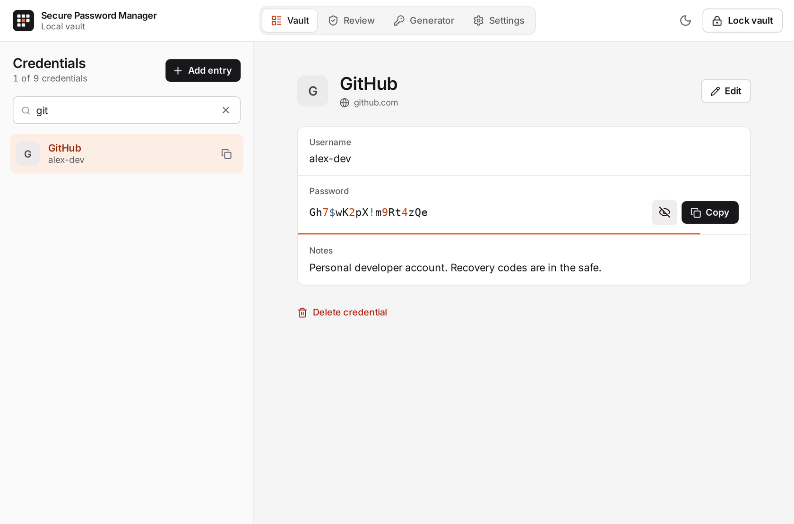

<div align="center">
  
  <h1>Secure Password Manager</h1>
  <p>An offline password manager for Ubuntu with a local encrypted vault and a Python CLI.</p>
  <p>
    <a href="https://github.com/santipvz/SecurePasswordManager/releases/latest"></a>
    <a href="#install-on-ubuntu"></a>
    <a href="LICENSE"></a>
    <a href="https://github.com/santipvz/SecurePasswordManager/actions/workflows/pylint.yml?query=branch%3Adevelop"></a>
    <a href="https://github.com/santipvz/SecurePasswordManager/actions/workflows/desktop.yml?query=branch%3Adevelop"></a>
    <a href="https://github.com/santipvz/SecurePasswordManager/actions/workflows/security.yml?query=branch%3Adevelop"></a>
  </p>
  <p>
    <a href="#install-on-ubuntu"><strong>Install on Ubuntu</strong></a> ·
    <a href="https://santipvz.github.io/SecurePasswordManager/">Try the browser demo</a> ·
    <a href="#use-the-vault">Use the vault</a> ·
    <a href="#command-line">Command line</a> ·
    <a href="#security-and-compatibility">Security</a>
  </p>
  <picture>
    <source media="(prefers-reduced-motion: reduce)" srcset="desktop/docs/desktop-demo-poster.png">
    <source type="image/webp" srcset="desktop/docs/desktop-demo.webp">
    
  </picture>
  <p><a href="desktop/docs/desktop-demo.mp4">Watch the 49-second desktop demo (MP4, 1080p60)</a></p>
</div>

## Install on Ubuntu

The desktop package supports **Ubuntu 24.04 LTS (amd64)** and includes its own Python runtime.

1. Download `secure-password-manager_1.1.0_amd64.deb` and `SHA256SUMS` from [the 1.1.0 release](https://github.com/santipvz/SecurePasswordManager/releases/tag/v1.1.0).
2. From the download directory, check the checksum and verify the GitHub build attestation before installing. Use a version of [GitHub CLI](https://cli.github.com/manual/gh_attestation_verify) that supports `gh attestation verify` and sign in with `gh auth login` if prompted.

   ```sh
   sha256sum --check SHA256SUMS &&
     gh attestation verify secure-password-manager_1.1.0_amd64.deb \
       --repo santipvz/SecurePasswordManager \
       --signer-workflow santipvz/SecurePasswordManager/.github/workflows/desktop.yml \
       --source-ref refs/heads/main &&
     sudo apt install ./secure-password-manager_1.1.0_amd64.deb
   ```

3. Open **Secure Password Manager** from the applications menu.

If you are upgrading, save an encrypted backup from **Settings** and close the app before installing. Choose **Open vault file** if your existing `.spm` file is in a custom location. The [desktop guide](desktop/README.md) covers upgrades, the default vault path, and YubiKey device access.

## Use the vault

1. Choose **Create vault**, pick a location for the `.spm` file, and set a unique master password of at least 15 characters. Use **Open vault file** to open an existing vault.
2. Choose **Add entry**, then enter a password or select **Open password generator → Use password**. Choose **Save credential** to store it with its name, username, website, and notes.
3. Press **Ctrl+K** to search by name, username, or website. Select an entry to view it, edit it, or copy its password. Choose **Lock vault** when you finish. The app also locks after five minutes of inactivity.

| If you want to… | Open |
| --- | --- |
| Generate a password of 12–256 characters without saving it | **Generator** or **Password generator** on the lock screen |
| Find short or reused passwords | **Review** |
| Save or test an encrypted backup | **Settings → Save backup** or **Open backup** |
| Unlock with a compatible USB security key | **Settings → Register YubiKey**, then select **YubiKey** on the unlock screen |
| Import legacy `.key` files | **Settings → Import .key files**. The original files remain on disk in plaintext. |

Keep the master password for recovery. Backups retain the unlock methods they had when saved. Follow the [desktop guide](desktop/README.md) for backup, restore, and hardware key details.

## Command line

Install from the repository with **Python 3.11 or later**.

```sh
git clone https://github.com/santipvz/SecurePasswordManager.git
cd SecurePasswordManager
python3 -m venv .venv
source .venv/bin/activate
python -m pip install .
cpass --help
```

In Windows PowerShell, use `py -3 -m venv .venv` to create the environment and `.venv\Scripts\Activate.ps1` to activate it. You can also run the CLI with `python -m spm`.

```sh
cpass init
cpass generate --length 24
cpass add "Personal email" --username ana@example.org --generate
cpass list email
cpass audit
cpass backup vault-backup.spm
cpass --vault vault-backup.spm list
```

`cpass generate` prints a password without saving it. `cpass add --generate` saves a generated password directly to the vault. Omit `--generate` to enter an existing password at a hidden prompt. Use `cpass edit "Personal email" --prompt-password` to replace it and `--prompt-notes` with `add` or `edit` to enter sensitive notes privately. Adding `--password` or `--notes` to `cpass show "Personal email"` writes sensitive values to standard output.

Run `cpass import-key first.key second.key` to import legacy files. The import uses filenames as credential names and cancels the whole batch if a file is invalid or a name is duplicated. The original files remain on disk in plaintext.

### Python desktop and FIDO2

Run `cpass-desktop` for the Tkinter interface. On Debian or Ubuntu, install `python3-tk` if Tkinter is missing. Use **New credential** to add an entry, **Review vault** to check passwords, and **File → Save encrypted backup…** to back up the vault.

Install the optional FIDO2 support with `python -m pip install ".[yubikey]"`. Register a compatible key with **File → Register FIDO2 key…** or `cpass key-add`. To unlock, choose **Use FIDO2 key** in the Python desktop app or run `cpass --security-key list`. The key needs `hmac-secret`, `credProtect`, and a FIDO2 PIN or fingerprint. Windows also needs WebAuthn PRF support. [YubiKey FIDO2 compatibility](https://docs.yubico.com/hardware/yubikey/yk-tech-manual/yk5-apps-fido.html) · [Linux device permissions](https://developers.yubico.com/yubikey-manager/Device_Permissions.html)

## Security and compatibility

- The `.spm` vault encrypts credential names, usernames, websites, passwords, and notes with AES-256-GCM. Argon2id derives the master-password key. Password generation and review run locally.
- The app can open existing `.spm` vaults in both formats. Version 1 uses the master password. Version 2 also supports a registered FIDO2 key. Changing the master password rotates the active vault key and clears the active hardware key registration.
- Encryption protects data at rest. Clipboard history and software running on the same computer can expose secrets while the vault is in use. The project has yet to undergo an independent security audit.

See the [threat model](THREAT_MODEL.md) for security boundaries and [SECURITY.md](SECURITY.md) for private vulnerability reporting.

## Contributing

| Guide | What it covers |
| --- | --- |
| [Contributing](CONTRIBUTING.md) | Branches, commits, and PR review |
| [Architecture](ARCHITECTURE.md) | The shared vault core and its adapters |
| [Desktop development](desktop/README.md#develop) | Running Tauri and the browser preview with fictional data |
| [CI and releases](CI.md) | Reproducing checks, verifying packages, and measuring desktop performance |

Released under the [MIT license](LICENSE).
